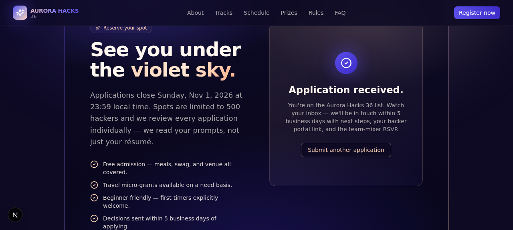

# 🌌 Aurora Hacks 36

> **From dusk to dawn, build the future.**
> A 36-hour overnight hackathon website — built for the GDG task brief.



## ✨ The concept

**Aurora Hacks 36** is a fictional 36-hour overnight hackathon. The site's
theme — *"From Dusk to Dawn"* — mirrors the actual arc of an overnight build
session: deep **ultra violet** night fading into a warm **soft apricot**
sunrise. The palette and motion design (drifting orbs, animated starfield,
shimmer text) are tuned to that arc.

- **Name:** Aurora Hacks 36
- **Tagline:** From dusk to dawn, build the future.
- **Palette:** Ultra Violet `#5B4DE8` · Soft Apricot `#FFD3B6` · Cosmos `#0E0A24`
- **Stack:** Next.js 16 · TypeScript 5 · Tailwind CSS 4 · shadcn/ui

## 📦 Sections

1. **Hero** — animated starfield + live countdown to Nov 14, 2026 10:00 (SSR-safe)
2. **About** — narrative, four stats, three community pillars, manifesto quote
3. **Tracks** — 4 interactive track cards with starter prompts
   - AI & Machine Intelligence
   - Climate & Sustainability
   - Health & Wellbeing
   - Future of Work & Education
4. **Schedule** — full 36-hour timeline, filterable by category
5. **Prizes** — $15K+ total: grand prize, 4 track winners, runner-up, special awards
6. **Rules** — 4 grouped cards + Code of Conduct callout
7. **FAQ** — accordion (one-open-at-a-time)
8. **Register** — working form with simulated async submission + success state
9. **Footer** — socials, contact, sitemap

## 🚀 Quick start

```bash
# 1. install deps
bun install

# 2. copy env
cp .env.example .env

# 3. run dev server
bun run dev
# → http://localhost:3000
```

> Requires Node 18+ and `bun` (or `npm` / `pnpm` / `yarn`).

## 🗂 Project structure

```
src/
├── app/
│   ├── globals.css       # Aurora brand palette, gradient utilities, animations
│   ├── layout.tsx        # metadata + fonts
│   └── page.tsx          # section composition
├── components/
│   ├── aurora/           # All hackathon-specific sections
│   │   ├── Navbar.tsx
│   │   ├── Hero.tsx
│   │   ├── About.tsx
│   │   ├── Tracks.tsx
│   │   ├── Schedule.tsx
│   │   ├── Prizes.tsx
│   │   ├── Rules.tsx
│   │   ├── Faq.tsx
│   │   ├── Register.tsx
│   │   ├── Footer.tsx
│   │   ├── Countdown.tsx
│   │   └── data.ts       # all hackathon content (tracks, schedule, prizes, rules, FAQ)
│   └── ui/               # shadcn/ui components
└── lib/
    └── utils.ts
```

All hackathon content (tracks, schedule, prizes, rules, FAQ, socials) lives in
**`src/components/aurora/data.ts`** — edit that single file to change anything.

## 🎨 Design system

| Token | Hex | Use |
|-------|-----|-----|
| Ultra Violet | `#5B4DE8` | primary brand |
| Violet Deep | `#3D2BC9` | hover / accents |
| Violet Soft | `#8B7FEF` | gradients |
| Soft Apricot | `#FFD3B6` | warm accent / text |
| Apricot Deep | `#FFB088` | highlights |
| Cosmos | `#0E0A24` | background base |
| Cream | `#FFF7F0` | foreground text |

Custom utilities in `globals.css`:

- `.aurora-bg` — radial + linear gradient backdrop
- `.aurora-text-warm` / `.shimmer-text` — gradient text effects
- `.glass-card` / `.glass-card-warm` — frosted card backgrounds
- `.glow-violet` / `.glow-apricot` — colored drop-shadows
- `.star-field` — tiny twinkling dots via radial gradients
- `animate-drift` / `animate-float` / `animate-pulse-glow` — ambient motion

## ✅ Verified

All interactions tested via `agent-browser`:

- [x] Page renders cleanly (no hydration crashes)
- [x] Track tab switching updates active state
- [x] Schedule filter shows only matching categories
- [x] Registration form: fill → submit → success state + toast
- [x] FAQ accordion (one-open-at-a-time)
- [x] Mobile hamburger menu expands all nav links
- [x] Lint passes (`bun run lint`)
- [x] No console errors

## 📝 Task brief coverage

- [x] Hackathon name and theme
- [x] About the hackathon
- [x] 36-hour timeline / schedule
- [x] Problem statements and/or hackathon tracks
- [x] Rules and guidelines
- [x] Prizes
- [x] Registration / Call-to-Action section
- [x] Contact and/or social media section
- [x] Color palette: ultra violet + soft apricot

## 📄 License

MIT — see `LICENSE` (or feel free to add one).

Built with curiosity, fueled by apricot-colored coffee. ☀️
